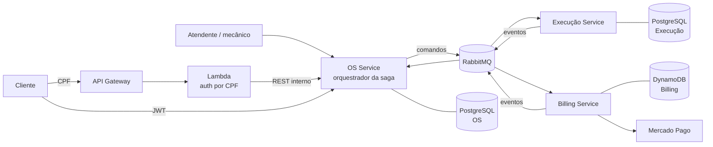

# Oficina — OS Service

[](https://sonarcloud.io/summary/overall?id=GustavoKikey_oficina-os-service)
[](https://sonarcloud.io/component_measures?id=GustavoKikey_oficina-os-service&metric=coverage)
[](https://github.com/GustavoKikey/oficina-os-service/actions/workflows/ci.yml)
[](https://github.com/GustavoKikey/oficina-os-service/actions/workflows/cd.yml)

Microsserviço de **ordens de serviço** da oficina mecânica (Tech Challenge FIAP SOAT,
**fase 4**). Cuida de clientes, veículos, login de funcionários, ciclo de vida e
histórico da OS, área do cliente (JWT por CPF) e **orquestra a saga** que coordena
Execução e Billing.

> **Situação:** implementado e validado na AWS em 2026-11-16 — o fluxo completo de uma OS
> rodou no EKS, passando pelos três serviços, com pagamento real no Mercado Pago (conta de
> teste) e saga `CONCLUIDA` ([detalhes](#validação-na-aws)).
>
> 🎬 **Vídeo de demonstração:** _link adicionado após a gravação_

---

## Entrega da fase 4 — onde está cada requisito

| Requisito do enunciado | Onde está |
| --- | --- |
| **≥ 3 microsserviços**, cada um com repositório, infraestrutura e banco próprios | [OS](https://github.com/GustavoKikey/oficina-os-service), [Execução](https://github.com/GustavoKikey/oficina-execucao-service) e [Billing](https://github.com/GustavoKikey/oficina-billing-service); cada um com o seu `infra/` (Terraform) e o seu banco |
| **≥ 1 banco SQL e ≥ 1 NoSQL** | PostgreSQL no OS e na Execução (RDS); **DynamoDB** no Billing ([ADR 009](https://github.com/GustavoKikey/oficina-os-service/blob/main/docs/fase-4/adr/adr-009-dynamodb-no-billing.md)) |
| **REST síncrono** quando necessário + **mensageria assíncrona** | REST nas APIs de cada serviço e na rota interna da Lambda; **RabbitMQ** entre os serviços ([contratos](https://github.com/GustavoKikey/oficina-os-service/blob/main/docs/fase-4/contratos-mensagens.md), [ADR 008](https://github.com/GustavoKikey/oficina-os-service/blob/main/docs/fase-4/adr/adr-008-rabbitmq.md)) |
| **Nenhum serviço acessa o banco de outro** | Cada serviço só recebe a URL e a senha do próprio banco; a Lambda de login consulta o cliente pela API do OS Service ([ADR 011](https://github.com/GustavoKikey/oficina-os-service/blob/main/docs/fase-4/adr/adr-011-lambda-consulta-os-service.md)) |
| **Saga com rollback e compensação** em qualquer etapa | Saga **orquestrada** neste serviço — [seção abaixo](#saga-orquestrada-e-por-quê), [saga.md](https://github.com/GustavoKikey/oficina-os-service/blob/main/docs/fase-4/saga.md), [ADR 007](https://github.com/GustavoKikey/oficina-os-service/blob/main/docs/fase-4/adr/adr-007-saga-orquestrada.md) |
| **Escolha da saga documentada e justificada no README** | [Saga: orquestrada, e por quê](#saga-orquestrada-e-por-quê) |
| **Testes unitários** em todos os microsserviços | JUnit 5 + Mockito nos três serviços; Vitest na Lambda |
| **Fluxo completo testado com BDD** | [`ciclo-de-vida-da-os.feature`](src/test/resources/features/ciclo-de-vida-da-os.feature) (Cucumber, em português): do balcão à entrega + as 5 falhas que compensam |
| **Cobertura ≥ 80% por serviço** | Gate do JaCoCo no build; SonarCloud: **94,7%** (OS), **94,7%** (Execução), **91,6%** (Billing) — [evidências](#qualidade-e-cobertura) |
| **SonarQube (ou similar) no CI** | SonarCloud com quality gate obrigatório no PR ([painel](https://sonarcloud.io/organizations/gustavokikey/projects)) |
| **CI/CD independente**: build, testes, qualidade, deploy em Kubernetes | `ci.yml` + `cd.yml` em cada serviço ([CI/CD](#cicd)); o CD só roda depois do CI verde |
| **Repositórios protegidos** (PR obrigatório e checagens) | `main` protegida nos 5 repositórios: merge só por PR, com 3 checagens obrigatórias |
| **Mensageria** para a orquestração | RabbitMQ no EKS, provisionado pelo [oficina-infra-k8s](https://github.com/GustavoKikey/oficina-infra-k8s) |
| **Observabilidade da fase 3** reaproveitada | New Relic: traces distribuídos (OTLP), métricas, logs, painel e alertas da saga — [Observabilidade](#observabilidade) |
| **Integração com o Mercado Pago** | Billing: Checkout Pro + consulta da API + estorno ([RFC 004](https://github.com/GustavoKikey/oficina-os-service/blob/main/docs/fase-4/rfc/rfc-004-integracao-mercado-pago.md)); validado com pagamento real |
| **Entregáveis de cada repositório** | Código-fonte · `Dockerfile` · manifestos em `k8s/` · pipelines em `.github/workflows/` · evidência de cobertura (badges e links) · documentação da arquitetura · **Swagger** (`/swagger` e [`docs/openapi.yaml`](docs/openapi.yaml)) |

## Visão geral



Na AWS, os três serviços e o RabbitMQ rodam no EKS; o desenho completo da implantação está em
[arquitetura.md](https://github.com/GustavoKikey/oficina-os-service/blob/main/docs/fase-4/arquitetura.md#implantação-na-aws).


## Documentação da arquitetura

A documentação do sistema inteiro vive neste repositório, em [`docs/fase-4/`](docs/fase-4/):

| Documento | Conteúdo |
| --- | --- |
| [arquitetura.md](docs/fase-4/arquitetura.md) | **Ponto de entrada**: divisão em serviços, bancos, comunicação, mapa requisito → onde |
| [saga.md](docs/fase-4/saga.md) | Saga orquestrada: fluxo, máquina de estados, compensações, prazos |
| [contratos-mensagens.md](docs/fase-4/contratos-mensagens.md) | Filas, exchanges, envelope e cada comando/evento |
| [ADRs 006–012](docs/fase-4/adr/) | Decisões: divisão, orquestração, RabbitMQ, DynamoDB, outbox, Lambda, implantação na AWS |
| [RFC 004](docs/fase-4/rfc/rfc-004-integracao-mercado-pago.md) | Integração com o Mercado Pago |

## Saga: orquestrada, e por quê

A OS passa por três serviços (abertura → diagnóstico → orçamento → aprovação → pagamento →
reparo → entrega), e qualquer passo pode falhar depois de outros já terem feito efeito. A
coordenação é uma **saga orquestrada**: este serviço guarda o estado de cada saga, envia
**comandos** a Execução e Billing pelo RabbitMQ e reage aos **eventos** que eles respondem.

**Por que orquestrada e não coreografada** ([ADR 007](https://github.com/GustavoKikey/oficina-os-service/blob/main/docs/fase-4/adr/adr-007-saga-orquestrada.md)):

- **O fluxo tem um dono natural.** Quem responde ao cliente "em que pé está minha OS" é o OS
  Service; com coreografia, essa resposta teria de ser montada juntando eventos de três
  serviços.
- **As compensações dependem de onde a falha aconteceu.** Pagamento recusado cancela o
  orçamento e libera as peças; peça indisponível depois do pagamento **estorna** e libera. Um
  orquestrador decide isso num único lugar, testável como máquina de estados pura
  (`SagaOrdemServico`), em vez de espalhar a regra em consumidores de evento.
- **Prazo e falha precisam de alguém olhando.** Sem resposta de um participante, a saga
  reenvia com backoff e, esgotadas as tentativas, vai para `FALHA` e dispara alerta. Na
  coreografia, "ninguém respondeu" não tem dono.

| Falha em | Compensação |
| --- | --- |
| Orçamento não gerado | Execução cancela a ordem (libera reservas) |
| Cliente recusa / prazo de aprovação vence | Execução cancela; Billing cancela o orçamento |
| Pagamento recusado / link vencido | Execução cancela; Billing cancela o orçamento |
| Reparo não liberado (peça acabou) | Execução cancela; Billing **estorna** o pagamento |

Garantias: outbox transacional e consumidor idempotente nos três serviços
([ADR 010](https://github.com/GustavoKikey/oficina-os-service/blob/main/docs/fase-4/adr/adr-010-outbox-e-consumidor-idempotente.md)), prazos com reenvio e
endpoint administrativo para acompanhar e reprocessar (`/admin/sagas`). Detalhes em
[saga.md](docs/fase-4/saga.md).

## Os repositórios da fase 4

| Repositório | Papel |
| --- | --- |
| **oficina-os-service** (este) | OS, clientes, veículos, orquestrador da saga |
| [oficina-execucao-service](https://github.com/GustavoKikey/oficina-execucao-service) | Fila de execução, diagnóstico, reparo, estoque |
| [oficina-billing-service](https://github.com/GustavoKikey/oficina-billing-service) | Orçamento e pagamento (Mercado Pago) |
| [oficina-infra-k8s](https://github.com/GustavoKikey/oficina-infra-k8s) | Cluster EKS e RabbitMQ |
| [oficina-auth-lambda](https://github.com/GustavoKikey/oficina-auth-lambda) | Autenticação do cliente por CPF |

## Arquitetura do serviço

Clean Architecture, como na fase 3: cada módulo de negócio tem `entities` (regras), `usecases` (fluxos), `gateways` (portas), `controllers`, `presenters` e `dtos`; tudo o que toca framework, banco ou rede fica em `external`, e o domínio não conhece Quarkus, banco nem RabbitMQ.

| Módulo | Responsabilidade |
| --- | --- |
| `atendimento` | Clientes, veículos, abertura e ciclo de vida da OS, histórico, área do cliente |
| `saga` | **Orquestrador**: máquina de estados da saga, prazos, compensações, reprocessamento |
| `seguranca` | Login de funcionários e emissão do JWT |
| `relatorio` | Tempo médio de execução |
| `shared` | Tipos de domínio comuns (documento, dinheiro, ids) |
| `external` | Adaptadores: REST (`api`), PostgreSQL (`persistence`), RabbitMQ com outbox e inbox (`messaging`), e-mail, métricas, segurança |

## Stack

Java 21 · Quarkus 3.40 (LTS) · PostgreSQL 16 + Flyway · RabbitMQ (SmallRye Reactive
Messaging) · JWT RS256 · OpenTelemetry + Micrometer + logs JSON (New Relic) · JUnit 5,
REST-Assured, Testcontainers · JaCoCo (gate de 80%) · SonarCloud · Docker · Kubernetes (EKS)

## Executar localmente

Pré-requisitos: Docker e JDK 21. O Maven vem pelo wrapper (`./mvnw`).

**Só este serviço, em modo dev:** o Quarkus sobe PostgreSQL e RabbitMQ sozinho (Dev Services).

```bash
./mvnw quarkus:dev
```

**O sistema inteiro:** com os três repositórios clonados lado a lado na mesma pasta:

```bash
docker compose up -d --build
```

| Endereço | O quê |
| --- | --- |
| http://localhost:8080/swagger | OS Service |
| http://localhost:8081/swagger | Execução Service |
| http://localhost:8082/swagger | Billing Service |
| http://localhost:15672 | Painel do RabbitMQ (`oficina` / `oficina`) |
| http://localhost:16686 | Jaeger: traces distribuídos |

**A saga de ponta a ponta:** [`scripts/fluxo-completo.py`](scripts/fluxo-completo.py) faz o
papel do atendente, do mecânico e da cliente contra os três serviços no ar:

| Cenário | O que mostra | Desfecho |
| --- | --- | --- |
| `feliz` | Abertura → diagnóstico → orçamento → aprovação → pagamento → reparo → entrega | saga `CONCLUIDA` |
| `recusa` | Pagamento recusado: a Execução devolve as peças e o Billing cancela o orçamento | saga `COMPENSADA` |
| `estorno` | Reserva vencida, outra OS consome a peça, o reparo não é liberado e o pagamento é estornado | saga `COMPENSADA` |

```bash
# local (o estorno precisa de reserva curta)
RESERVA_VALIDADE=PT20S docker compose up -d --build
python scripts/fluxo-completo.py

# na AWS: a cliente entra com o CPF pela Lambda; pagamento real no Mercado Pago (conta de teste)
python scripts/fluxo-completo.py --nuvem --cenario feliz --mercadopago --pausar
```

## Testes

```bash
./mvnw verify
```

Roda os testes unitários e os que sobem a aplicação contra PostgreSQL e RabbitMQ reais
(Testcontainers), e **falha o build se a cobertura do serviço ficar abaixo de 80%**.
O relatório fica em `target/site/jacoco/index.html`.

**BDD.** O ciclo de vida completo da OS está descrito em Gherkin, em português, em
[`ciclo-de-vida-da-os.feature`](src/test/resources/features/ciclo-de-vida-da-os.feature):
do balcão à entrega, e as cinco falhas que fazem a saga compensar (orçamento não gerado,
recusa do cliente, pagamento recusado, link vencido e reparo não liberado com estorno).
Os cenários rodam no `verify`, com a aplicação inteira no ar; Execução e Billing entram
pelas mensagens que publicariam. Só eles:

```bash
./mvnw verify -Dit.test=CicloDeVidaDaOsBddIT -Dtest=none -Dsurefire.failIfNoSpecifiedTests=false -Djacoco.skip=true
```

Relatório: `target/cucumber/ciclo-de-vida-da-os.html`. No CI, os cenários aparecem no
resumo de cada execução e o relatório fica nos artefatos (`relatorio-bdd`).

## Qualidade e cobertura

| Onde | O quê |
| --- | --- |
| [SonarCloud](https://sonarcloud.io/summary/overall?id=GustavoKikey_oficina-os-service) | Quality gate da `main` e de cada PR (badges no topo, atualizados a cada análise). Em 2026-11-16: cobertura **94,7%**, 0 bugs, 0 vulnerabilidades, 0 code smells |
| [Resumo de cada execução do CI](https://github.com/GustavoKikey/oficina-os-service/actions/workflows/ci.yml) | Tabela de cobertura do JaCoCo (instruções, branches, linhas) e os cenários BDD; relatório completo no artefato `relatorio-jacoco` |
| Build local | `./mvnw verify` falha abaixo de **80%**; relatório em `target/site/jacoco/index.html` |

## API (Swagger)

Swagger UI em **`/swagger`** de cada serviço (local: http://localhost:8080/swagger; na AWS, pelo
load balancer público). A especificação OpenAPI exportada do serviço em execução está
versionada em [`docs/openapi.yaml`](docs/openapi.yaml).

**Autenticação:** funcionários fazem `POST /auth/login` e usam o token no botão *Authorize*;
clientes recebem o token da Lambda (`POST /auth/cliente` no API Gateway, com o CPF). As rotas
`/cliente/**` só mostram as OS do próprio cliente.

| Rota | Quem | O quê |
| --- | --- | --- |
| `POST /ordens-servico` | Atendente | Abre a OS (cria cliente e veículo se preciso) e inicia a saga |
| `GET /ordens-servico/{id}` · `/status` · `/historico` | Funcionários | Detalhe, status e histórico de transições |
| `POST /ordens-servico/{id}/orcamento/aprovar` · `/recusar` | Atendente | Decisão do orçamento no balcão |
| `POST /ordens-servico/{id}/entregar` | Atendente | Entrega ao cliente (fecha a OS) |
| `GET /cliente/ordens-servico` · `/{id}/status` | Cliente | As próprias OS, com o link de pagamento |
| `POST /cliente/ordens-servico/{id}/orcamento/decisao` | Cliente | Aprova ou recusa o próprio orçamento |
| `GET /admin/sagas/{osId}` · `POST .../reprocessar` | Administrador | Estado da saga, mensagens trocadas e reprocessamento de uma saga em `FALHA` |
| `GET /relatorios/tempo-medio-execucao` | Administrador | Tempo médio por fase |

A rota interna da Lambda (`GET /internal/clientes`) fica **fora** do Swagger: exige o
`X-Internal-Token` e só é alcançável pelo load balancer interno, dentro da VPC.

## Observabilidade

A mesma do Tech Challenge da fase 3, o **New Relic**, agora com rastreamento entre serviços:

| Sinal | Como |
| --- | --- |
| **Traces distribuídos** | OpenTelemetry → OTLP → New Relic. O outbox guarda o `traceparent` junto com cada mensagem, e a publicação continua o trace original: abrir uma OS, concluir um diagnóstico ou pagar aparecem como **um único trace** atravessando os três serviços e o RabbitMQ |
| **Métricas de negócio** | Micrometer/Prometheus: OS abertas, sagas concluídas, compensadas (por motivo) e em falha (por passo), duração por fase, falhas de integração |
| **Logs** | JSON estruturado com `traceId` e `correlationId` (= id da OS), coletados pelo agente do cluster |
| **Painel e alertas** | "Oficina — Saga (fase 4)" e a policy "Oficina — Saga" (saga em `FALHA`, mensagem na DLQ, pico de compensações, falha de integração), criados como código por [`newrelic-saga.py`](https://github.com/GustavoKikey/oficina-infra-k8s/blob/main/scripts/newrelic-saga.py) |
| **Local** | Jaeger no docker compose (http://localhost:16686), com o mesmo trace distribuído |

## Mensageria

| Direção | Exchange / fila | Conteúdo |
| --- | --- | --- |
| Publica | `oficina.comandos` (direct) | Comandos da saga para Execução (`rk: execucao`) e Billing (`rk: billing`) |
| Consome | `os.eventos` ← `oficina.eventos` (`execucao.#`, `billing.#`) | Respostas e eventos dos participantes |
| DLQ | `os.eventos.dlq` | Mensagens rejeitadas após as retentativas |

## CI/CD

| Workflow | Quando | O quê |
| --- | --- | --- |
| [`ci.yml`](.github/workflows/ci.yml) | PR para a `main` e push na `main` | Build, testes, gate de cobertura, SonarCloud (o plano gratuito analisa só PRs e a `main`), imagem Docker, kubeconform |
| [`cd.yml`](.github/workflows/cd.yml) | CI **verde** num commit da `main` | Imagem no ECR e [`scripts/implantar.sh`](scripts/implantar.sh) no EKS (`hom`); `prod` por *Run workflow*. Com a sessão do Learner Lab fechada, pula com aviso |
| [`infra.yml`](.github/workflows/infra.yml) | PR que mexe em `infra/`; aplicar sob comando | fmt, validate e tflint; apply/destroy no *Run workflow* |

`main` protegida: merge só por Pull Request, com as três checagens do CI obrigatórias. O
`ci.yml` e o `cd.yml` são idênticos nos três serviços.

## Implantação na AWS

**Infraestrutura própria** ([`infra/`](infra/), Terraform): RDS PostgreSQL `oficina-{env}-os`, par de chaves RSA do JWT (Secrets Manager + SSM) e o token da rota interna. Publica no SSM
(`/oficina/{env}/...`): `os/db/jdbc-url`, `os/db/secret-arn`, `jwt/public-key`, `jwt/private-key-secret-arn`, `os/token-interno`. Depende só da plataforma
([oficina-infra-k8s](https://github.com/GustavoKikey/oficina-infra-k8s)), lida também pelo SSM.

**Deploy** ([`scripts/implantar.sh`](scripts/implantar.sh), chamado pelo `cd.yml` ou à mão):
cria os Secrets, aplica os manifestos de [`k8s/`](k8s/) com a imagem nova (os pods só
reiniciam quando a imagem ou a configuração mudam), espera o rollout e faz o smoke test.
Depois do rollout, publica o endereço do LB interno em `/oficina/{env}/os/url-interna`: é dali que a Lambda o lê ([ADR 011](https://github.com/GustavoKikey/oficina-os-service/blob/main/docs/fase-4/adr/adr-011-lambda-consulta-os-service.md)).

| Secret no cluster | Origem | Para quê |
| --- | --- | --- |
| `oficina-os-db` | Secrets Manager (`os/db/secret-arn`) | usuário e senha do banco |
| `oficina-os-jwt` | Secrets Manager + SSM (`jwt/*`) | chaves privada e pública do JWT |
| `oficina-os-interno` | SSM (`os/token-interno`) | `X-Internal-Token` da rota da Lambda |
| `oficina-os-rabbitmq` | plataforma (`oficina-infra-k8s`) | usuário do RabbitMQ |
| `oficina-newrelic` | secret `NEW_RELIC_LICENSE_KEY` do repositório | opcional: liga a telemetria |

Exposição: Service `LoadBalancer` público, que **nasce fechado** e é aberto para o IP de quem
vai usar (`scripts/liberar-meu-ip.sh` do oficina-infra-k8s); o Swagger fica em `/swagger`.

O ambiente inteiro (plataforma, bancos, deploy dos três serviços e Lambda) sobe com
`scripts/aplicar.sh hom` e cai com `scripts/destruir.sh hom`, no oficina-infra-k8s.
Decisões e custo: [ADR 012](https://github.com/GustavoKikey/oficina-os-service/blob/main/docs/fase-4/adr/adr-012-implantacao-na-aws.md).

## Validação na AWS

Em **2026-11-16**, o ambiente `hom` subiu inteiro com `scripts/aplicar.sh hom` (EKS 1.37,
RabbitMQ, dois RDS, DynamoDB, deploy dos três serviços pelo `cd.yml` e a Lambda), e o
`scripts/fluxo-completo.py --nuvem --cenario feliz --mercadopago` percorreu o fluxo completo:

```
OS de Alice: f18eb845-6176-46b2-a1bb-01be9bf2e541
✓ OS chegou à fila da Execução
  diagnóstico concluído pelo mecânico: 2 peça(s) reservada(s)
✓ orçamento gerado no Billing → AGUARDANDO_APROVACAO   (R$ 310,00)
  cliente Alice autenticada pela Lambda (JWT de 30 min)
  orçamento aprovado pela própria cliente, na área do cliente
✓ link de pagamento disponível  (Checkout Pro do Mercado Pago)
✓ o Billing recebeu a resposta do Mercado Pago  (pagamento aprovado, conta de teste)
✓ pagamento confirmado → Execução baixou as peças → saga EM_REPARO
✓ Execução comunicou a finalização → FINALIZADA
  histórico: RECEBIDA → EM_DIAGNOSTICO → AGUARDANDO_APROVACAO → AGUARDANDO_PAGAMENTO → EM_EXECUCAO → FINALIZADA → ENTREGUE
  saga: CONCLUIDA — 13 mensagens trocadas
```

A subida também revelou três problemas que só apareciam fora do ambiente local — scripts no
Git Bash do Windows, um `output` sensível do Terraform e o tempo de publicação da rota do API
Gateway —, corrigidos por PR em cada repositório.
