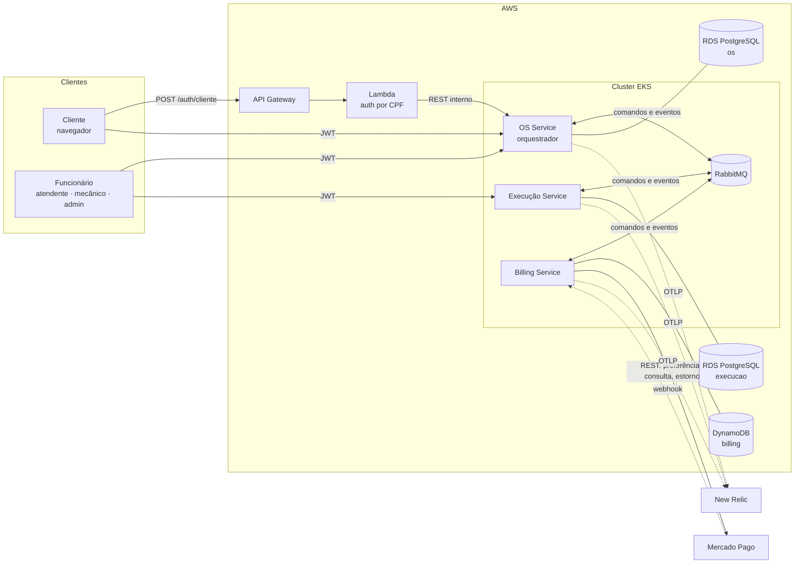

# Arquitetura da fase 4 — microsserviços com saga orquestrada

> **Ponto de entrada da documentação da fase 4.** Mapeia cada exigência do enunciado ao
> documento ou repositório que a atende. Escrito em **2026-11-15**, antes da
> implementação: descreve o **desenho aprovado**, não código que já existe. Cada seção
> será atualizada para "verificado" conforme os serviços forem entregues.

---

## 1. O problema

Até a fase 3, a oficina era **um processo só**. Abrir uma OS, reservar peças, aprovar
orçamento e baixar estoque aconteciam dentro da **mesma transação de banco**. O
[ADR 004 da fase 3](https://github.com/GustavoKikey/tech-challenge-15SOAT/blob/main/docs/fase-3/adr/adr-004-padrao-de-comunicacao.md)
registrou essa escolha e deixou a porta aberta: *"`reservas.ordem_servico_id` não tem FK
para `ordens_servico` justamente para que Estoque possa ser extraído mais tarde"*.

A fase 4 é esse "mais tarde". A oficina opera em escala nacional, e o enunciado pede
três coisas que um monolito não entrega:

1. **Serviços independentes**: cada um com repositório, banco, pipeline e deploy próprios.
2. **Nenhum serviço acessa o banco de outro.**
3. **Consistência sem transação distribuída.** Criar a OS, aprovar o orçamento e cobrar
   o cliente precisam terminar todos certos ou ser desfeitos com segurança. Isso é feito
   com uma **saga**.

---

## 2. Mapa: requisito → onde está

| Requisito da fase 4 | Onde está |
| --- | --- |
| ≥ 3 microsserviços, cada um com repo, infra e banco | §3 e [ADR 006](adr/adr-006-divisao-em-microsservicos.md) |
| Pelo menos um banco SQL e um NoSQL | §5: PostgreSQL (OS, Execução) e DynamoDB (Billing), [ADR 009](adr/adr-009-dynamodb-no-billing.md) |
| REST síncrono quando necessário + mensageria assíncrona | §4 e [ADR 008](adr/adr-008-rabbitmq.md) |
| Nenhum serviço acessa o banco de outro | §5 e [ADR 011](adr/adr-011-lambda-consulta-os-service.md) (a Lambda também deixa de acessar) |
| Saga com rollback e compensação; escolha documentada | [saga.md](saga.md) e [ADR 007](adr/adr-007-saga-orquestrada.md) |
| Integração com Mercado Pago | [RFC 004](rfc/rfc-004-integracao-mercado-pago.md) |
| Testes unitários, BDD em um fluxo completo, ≥ 80% por serviço, Sonar no CI | §8 |
| CI/CD independente com deploy em Kubernetes; `main` protegida | §9 |
| Observabilidade da fase 3 reaproveitada, com rastreamento distribuído | §7 |
| Contratos de comunicação | [contratos-mensagens.md](contratos-mensagens.md) |

---

## 3. Os três serviços

| Serviço | Responsabilidade | Banco | Origem do código |
| --- | --- | --- | --- |
| **OS Service** | Clientes, veículos, usuários e login de funcionários, **ciclo de vida e histórico da OS**, área do cliente (JWT por CPF), notificações, relatório de tempo médio. **Orquestra a saga.** | PostgreSQL (RDS) | BCs `atendimento` (parte), `seguranca` e `relatorio` do monolito |
| **Execução Service** | **Fila de execução**, diagnóstico (itens de serviço e peça), reparos, **catálogo de serviços** e **estoque de peças** (reservas e baixas). Comunica a finalização ao OS Service. | PostgreSQL (RDS próprio) | BC `estoque` do monolito + parte de `atendimento` (itens e catálogo); a fila é nova |
| **Billing Service** | Geração de orçamento, registro e verificação de pagamento no **Mercado Pago**, estorno. Informa a confirmação do pagamento ao OS Service. | **DynamoDB** | Novo (só o cálculo do orçamento vem do monolito) |

### Por que essa divisão

A divisão segue os **três momentos do negócio** que o enunciado descreve:
*atendimento*, *execução* e *cobrança*. Cada momento tem quem o opera (atendente,
mecânico, financeiro), seu próprio ritmo e seu próprio motivo para mudar. A
justificativa completa está no [ADR 006](adr/adr-006-divisao-em-microsservicos.md).
Três pontos merecem destaque:

- **O diagnóstico e o catálogo de serviços vão para a Execução**, não ficam na OS. Quem
  registra os itens é o mecânico, durante o diagnóstico, e o enunciado põe "atualizar
  status durante diagnóstico" na Execução. Deixar os itens na OS obrigaria a Execução a
  pedir à OS cada peça usada, ou vice-versa, a cada clique do mecânico.
- **O estoque fica com a Execução**, porque quem consome peça é o reparo. Reserva e
  baixa precisam de lock pessimista, e isso pede banco relacional.
- **O orçamento fica no Billing.** O enunciado coloca "geração e envio de orçamentos" no
  Billing, e o orçamento é o documento que dá origem à cobrança. A OS guarda só um
  resumo (id, valor total e link de pagamento) para mostrar ao cliente.

---

## 4. Comunicação

| De → Para | Tipo | Por quê |
| --- | --- | --- |
| Usuário → serviços | REST síncrono (JWT RS256) | Alguém está esperando a resposta |
| OS ↔ Execução, OS ↔ Billing | **Assíncrono, RabbitMQ** (comandos e eventos) | Etapas da saga; o outro serviço pode estar fora do ar sem travar quem chama |
| Lambda → OS Service | REST síncrono, interno à VPC | Login precisa de resposta imediata ([ADR 011](adr/adr-011-lambda-consulta-os-service.md)) |
| Billing → Mercado Pago | REST síncrono | API externa; falhas tratadas com retentativa e consulta periódica |
| Mercado Pago → Billing | Webhook, com consulta periódica como garantia | Ver [RFC 004](rfc/rfc-004-integracao-mercado-pago.md) |

**Os serviços não fazem chamadas REST entre si.** Toda informação que um serviço
precisa do outro chega **dentro da mensagem** (event-carried state): por exemplo, o
comando que abre a ordem de execução já leva a placa e o modelo do veículo. Assim, um
serviço fora do ar atrasa o fluxo, mas não derruba quem está no ar.

---

## 5. Dados: um banco por serviço

| Serviço | Banco | Por quê |
| --- | --- | --- |
| OS | PostgreSQL | Agregado com máquina de estados, histórico e consultas relacionais (listagem ordenada, relatório). O schema da fase 3 é reaproveitado. |
| Execução | PostgreSQL | Estoque exige `SELECT … FOR UPDATE` para que duas OS não reservem a mesma peça. |
| Billing | **DynamoDB** | Orçamento e pagamento são documentos lidos sempre pela chave, com histórico de tentativas aninhado. Ver [ADR 009](adr/adr-009-dynamodb-no-billing.md). |

Regras:

- **Credenciais separadas.** Cada serviço só recebe o segredo do próprio banco; o
  Kubernetes não monta o segredo de um serviço no pod de outro.
- **Sem FK entre serviços.** Referências cruzadas são UUIDs (`os_id`, `orcamento_id`)
  sem integridade referencial, porque o outro lado vive em outro banco.
- **A Lambda de CPF também obedece.** Ela deixa de ler a tabela `clientes` e passa a
  chamar o OS Service ([ADR 011](adr/adr-011-lambda-consulta-os-service.md)).

---

## 6. Segurança

Continua o modelo da fase 3, agora compartilhado pelos três serviços:

- **Um único emissor por público.** Funcionários fazem login no OS Service; clientes
  pela Lambda (CPF). Os dois tokens são RS256, com o mesmo issuer e a mesma chave
  pública.
- **Cada serviço só valida o token**, de forma criptográfica e local, sem consultar
  ninguém. A chave pública é distribuída por ConfigMap.
- **O webhook do Mercado Pago é a única rota sem JWT.** Ele é autenticado pela
  assinatura HMAC (`x-signature`) e nunca é tratado como confiável: o Billing sempre
  confirma o status consultando a API do Mercado Pago antes de agir.

---

## 7. Observabilidade

A stack da fase 3 é reaproveitada sem troca de ferramenta: **OpenTelemetry + Micrometer
+ logs JSON → New Relic**.

O que a fase 4 acrescenta:

- **Trace distribuído atravessando a fila.** O conector RabbitMQ do SmallRye propaga o
  `traceparent` no cabeçalho da mensagem. O outbox **grava o `traceparent` junto com a
  mensagem**, para que a publicação, feita depois por outra thread, continue o mesmo
  trace. Resultado: uma OS do início ao fim aparece como **um único trace** passando
  pelos três serviços.
- **`correlationId` = id da OS** em todo log e mensagem: uma busca no New Relic traz o
  caminho inteiro de uma OS.
- **Métricas da saga**: `oficina_saga_iniciadas_total`, `oficina_saga_concluidas_total`,
  `oficina_saga_compensadas_total{motivo}`, `oficina_saga_falhas_total{passo}` e
  `oficina_saga_passo_duracao_seconds{passo}`. Também `oficina_pagamentos_total{status}`
  no Billing e `oficina_fila_execucao_tamanho` na Execução.
- **Alertas** (somam-se aos da fase 3): saga em `FALHA`, compensação que falhou e
  mensagem em DLQ.

---

## 8. Qualidade

| Exigência | Como |
| --- | --- |
| Testes unitários em todos os serviços | JUnit 5 + Mockito no núcleo (entities/usecases), como na fase 3 |
| Integração | Testcontainers: PostgreSQL, RabbitMQ e DynamoDB Local |
| **BDD de um fluxo completo** | Cucumber (extensão `quarkus-cucumber`) no OS Service, em Gherkin português: [`ciclo-de-vida-da-os.feature`](../../src/test/resources/features/ciclo-de-vida-da-os.feature). Um cenário percorre a OS do balcão à entrega, e um esquema de cenário cobre as cinco falhas da tabela de compensações (§4 da [saga](saga.md)), conferindo que só as compensações necessárias saem. A aplicação roda inteira; Execução e Billing entram pelo conector em memória do SmallRye. O relatório HTML vai para o resumo e os artefatos de cada execução do CI. |
| **≥ 80% por serviço** | JaCoCo com gate sobre o **serviço inteiro** (não só o núcleo, como era na fase 3). DTOs, config e código gerado ficam de fora. |
| Qualidade no CI | SonarCloud, com quality gate como check obrigatório do PR |

---

## 9. Repositórios e entrega

| Repositório | Conteúdo | Situação |
| --- | --- | --- |
| `oficina-os-service` | App + `k8s/` + `infra/` (RDS) + CI/CD + **esta documentação** | novo |
| `oficina-execucao-service` | App + `k8s/` + `infra/` (RDS) + CI/CD | novo |
| `oficina-billing-service` | App + `k8s/` + `infra/` (DynamoDB) + CI/CD | novo |
| `oficina-infra-k8s` | EKS + **RabbitMQ** | existente, ampliado |
| `oficina-auth-lambda` | Function de CPF, agora chamando o OS Service | existente, ajustado |
| `tech-challenge-15SOAT`, `oficina-infra-database` | Fases 1–3 | congelados como histórico |

Cada serviço tem **pipeline independente**: build → testes com gate → SonarCloud →
imagem no ECR → `kubectl apply` no EKS → smoke test. O padrão de branches da fase 3 se
mantém: PR obrigatório na `main`, `homolog` → `hom` e `main` → `prod`.

---

## 10. Ambiente local

Um `docker compose up` no OS Service sobe o sistema inteiro: os três serviços, dois
PostgreSQL, DynamoDB Local, RabbitMQ (com o painel de gerenciamento) e **Jaeger**, para
ver o trace distribuído sem precisar do New Relic. É nesse ambiente que o
desenvolvimento acontece e onde o fluxo do vídeo é ensaiado antes de ir para a AWS.

Os três repositórios precisam estar clonados lado a lado na mesma pasta.

---

## 11. Restrições do ambiente

| Restrição | Consequência no desenho |
| --- | --- |
| AWS Academy Learner Lab: credenciais de 4 h, sem criar IAM role | Pods acessam o DynamoDB pela role do nó (`LabRole`), sem IRSA. O ambiente é efêmero, como na fase 3. |
| Crédito limitado | RabbitMQ roda no cluster (Amazon MQ seria pago por hora). As instâncias RDS são `db.t3.micro`. |
| 3 JVMs + RabbitMQ + agente New Relic em nós `t3.medium` | Requests e limits ajustados (~384 Mi por serviço); o node group pode crescer até 3 nós. |
| Load balancer restrito por IP (fase 3) | O webhook do Mercado Pago precisa de uma rota pública. Ver [RFC 004](rfc/rfc-004-integracao-mercado-pago.md). Sem ela, a consulta periódica cobre o fluxo. |
