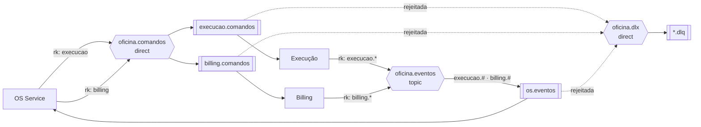

# Contratos de mensagens

> Desenho aprovado em **2026-11-15**. Este documento é a **fonte da verdade** dos
> contratos entre os serviços. Cada serviço tem as próprias classes de mensagem; não
> existe biblioteca compartilhada (ela acoplaria os deploys). Uma mudança de contrato
> começa aqui.

---

## 1. Topologia no RabbitMQ



| Elemento | Tipo | Observação |
| --- | --- | --- |
| `oficina.comandos` | exchange `direct` | Comando tem **um** destinatário. A routing key é o serviço (`execucao`, `billing`) |
| `oficina.eventos` | exchange `topic` | Evento é um fato publicado; quem quiser escuta. A routing key é `<origem>.<evento-em-kebab-case>` |
| `execucao.comandos`, `billing.comandos`, `os.eventos` | filas duráveis (quorum) | Uma fila de entrada por serviço; o tipo da mensagem decide o handler |
| `oficina.dlx` → `<fila>.dlq` | dead letter | Mensagem rejeitada após as retentativas. Qualquer mensagem aqui dispara alerta |

**Quem declara o quê.** Cada serviço declara as filas que consome e as exchanges onde
publica (declaração idempotente na subida). Ninguém depende de configuração manual no
RabbitMQ.

---

## 2. Envelope

Toda mensagem, comando ou evento, tem o mesmo envelope em JSON:

```json
{
  "messageId": "6f1c2a9e-3b7d-4e55-9a10-2f4b8c7d1e90",
  "type": "GerarOrcamento",
  "version": 1,
  "correlationId": "0b8e5f3a-1c2d-4e6f-8a9b-7c6d5e4f3a2b",
  "causationId": "d4e5f6a7-b8c9-4d0e-9f1a-2b3c4d5e6f70",
  "occurredAt": "2026-11-15T14:03:21.512Z",
  "source": "os-service",
  "payload": { }
}
```

| Campo | Regra |
| --- | --- |
| `messageId` | UUID único por mensagem. É a chave do inbox (deduplicação) |
| `type` | Nome do comando ou evento, em PascalCase. Também vai no header AMQP `type` |
| `version` | Versão do contrato daquele `type`. Mudança compatível (campo novo opcional) não muda a versão; mudança incompatível cria `version: 2`, e o consumidor aceita as duas durante a transição |
| `correlationId` | **Sempre o `osId`**, que também é o id da saga. Vai para o MDC dos logs |
| `causationId` | `messageId` da mensagem que causou esta (a resposta aponta para o comando) |
| `occurredAt` | Instante do fato, em UTC, ISO-8601 |
| `source` | `os-service`, `execucao-service` ou `billing-service` |

**Headers AMQP:** `traceparent` e `tracestate` (W3C Trace Context), gravados no outbox no
momento da transação e repassados na publicação; `content-type: application/json`.

Valores monetários são **string decimal com duas casas** (`"350.00"`), nunca `float`.

---

## 3. Comandos (OS Service → participantes)

### Para a Execução (`rk: execucao`)

#### `AbrirOrdemExecucao`
Coloca a OS na fila de diagnóstico.
```json
{
  "osId": "…",
  "veiculo": { "placa": "ABC1D23", "marca": "Fiat", "modelo": "Argo", "ano": 2022 },
  "relatoCliente": "Barulho na suspensão dianteira",
  "abertaEm": "2026-11-15T14:00:00Z"
}
```
Respostas: `OrdemExecucaoAberta`.
Idempotência: se já existe ordem para o `osId`, reenvia `OrdemExecucaoAberta`.

#### `LiberarParaReparo`
Pagamento confirmado: baixa as peças e coloca a OS na fila de reparo.
```json
{ "osId": "…", "orcamentoId": "…" }
```
Respostas: `ReparoLiberado` ou `ReparoNaoLiberado`.
Idempotência: ordem já liberada → reenvia `ReparoLiberado`.

#### `CancelarOrdemExecucao` (compensação)
Cancela a ordem e libera as reservas ativas.
```json
{ "osId": "…", "motivo": "ORCAMENTO_RECUSADO" }
```
`motivo`: `ORCAMENTO_NAO_GERADO`, `ORCAMENTO_RECUSADO`, `PRAZO_APROVACAO_VENCIDO`,
`PAGAMENTO_RECUSADO`, `PAGAMENTO_EXPIRADO`, `REPARO_NAO_LIBERADO`.
Respostas: `OrdemExecucaoCancelada`, também quando a ordem já estava cancelada ou nunca
existiu.

### Para o Billing (`rk: billing`)

#### `GerarOrcamento`
```json
{
  "osId": "…",
  "cliente": { "id": "…", "nome": "Alice Souza", "email": "alice@exemplo.com" },
  "itens": [
    { "tipo": "SERVICO", "referenciaId": "…", "descricao": "Alinhamento", "quantidade": 1, "valorUnitario": "120.00" },
    { "tipo": "PECA",    "referenciaId": "…", "descricao": "Pastilha de freio", "quantidade": 2, "valorUnitario": "95.00" }
  ]
}
```
Respostas: `OrcamentoGerado` ou `OrcamentoNaoGerado`.
Idempotência: um orçamento por `osId`; se já existir, reenvia `OrcamentoGerado`.

#### `SolicitarPagamento`
Registra a aprovação do orçamento e cria a cobrança no Mercado Pago.
```json
{ "osId": "…", "orcamentoId": "…", "aprovadoPor": "CLIENTE", "aprovadoEm": "…" }
```
`aprovadoPor`: `CLIENTE` (área do cliente) ou `ATENDENTE` (aprovação em nome do
cliente).
Respostas: `PagamentoSolicitado` e, depois, `PagamentoConfirmado`, `PagamentoRecusado`
ou `PagamentoExpirado`.
Idempotência: pagamento já criado para o orçamento → reenvia `PagamentoSolicitado` com o
mesmo link.

#### `CancelarOrcamento` (compensação)
```json
{ "osId": "…", "orcamentoId": "…", "motivo": "ORCAMENTO_RECUSADO" }
```
Respostas: `OrcamentoCancelado`. Se houver pagamento pendente no Mercado Pago, a
preferência é expirada.

#### `EstornarPagamento` (compensação)
```json
{ "osId": "…", "orcamentoId": "…", "motivo": "REPARO_NAO_LIBERADO" }
```
Respostas: `PagamentoEstornado` (o orçamento também passa a `ESTORNADO`) ou
`EstornoFalhou`, depois que as retentativas internas contra o Mercado Pago se esgotam.

---

## 4. Eventos (participantes → OS Service)

### Da Execução (`rk: execucao.*`)

| Evento | Payload | Quando |
| --- | --- | --- |
| `OrdemExecucaoAberta` | `osId`, `posicaoFila` | Resposta a `AbrirOrdemExecucao` |
| `DiagnosticoIniciado` | `osId`, `mecanicoId`, `iniciadoEm` | Mecânico iniciou o diagnóstico |
| `DiagnosticoConcluido` | `osId`, `diagnosticoIniciadoEm`, `concluidoEm`, `itens[]` (mesmo formato do `GerarOrcamento`), `reservas[]` (`pecaId`, `quantidade`, `validaAte`) | Itens registrados e peças reservadas |
| `ReparoLiberado` | `osId`, `liberadoEm` | Resposta a `LiberarParaReparo` |
| `ReparoNaoLiberado` | `osId`, `motivo` (`ESTOQUE_INSUFICIENTE`), `pecasFaltantes[]` | Resposta a `LiberarParaReparo` |
| `ReparoIniciado` | `osId`, `mecanicoId`, `iniciadoEm` | Informativo (não muda o estado da saga) |
| `ReparoFinalizado` | `osId`, `finalizadoEm` | Comunica a finalização ao OS Service |
| `OrdemExecucaoCancelada` | `osId`, `reservasLiberadas` | Confirmação da compensação |

### Do Billing (`rk: billing.*`)

| Evento | Payload | Quando |
| --- | --- | --- |
| `OrcamentoGerado` | `osId`, `orcamentoId`, `valorTotal`, `geradoEm` | Resposta a `GerarOrcamento` |
| `OrcamentoNaoGerado` | `osId`, `motivo` | Itens inválidos (por exemplo, valor negativo, lista vazia) |
| `PagamentoSolicitado` | `osId`, `orcamentoId`, `pagamentoId`, `linkPagamento`, `expiraEm` | Preferência criada no Mercado Pago |
| `PagamentoConfirmado` | `osId`, `orcamentoId`, `pagamentoId`, `valorPago`, `confirmadoEm` | Status `approved` confirmado **na API** do Mercado Pago |
| `PagamentoRecusado` | `osId`, `orcamentoId`, `pagamentoId`, `motivo` (`status_detail` do Mercado Pago) | Status `rejected` |
| `PagamentoExpirado` | `osId`, `orcamentoId`, `pagamentoId` | Link venceu sem pagamento aprovado |
| `OrcamentoCancelado` | `osId`, `orcamentoId` | Confirmação da compensação |
| `PagamentoEstornado` | `osId`, `orcamentoId`, `pagamentoId`, `valorEstornado`, `estornadoEm` | Confirmação da compensação |
| `EstornoFalhou` | `osId`, `orcamentoId`, `pagamentoId`, `erro` | Compensação esgotou as tentativas: a saga vai para `FALHA` |

---

## 5. Regras para quem consome

1. **Deduplicar pelo `messageId`** antes de qualquer efeito (inbox na mesma transação
   do efeito).
2. **Comando repetido não é erro.** Responda de novo com base no estado atual.
3. **Ignorar campos desconhecidos** (`FAIL_ON_UNKNOWN_PROPERTIES = false`): é o que
   permite evoluir contrato sem deploy sincronizado.
4. **Erro de negócio vira evento de resposta, não exceção.** `OrcamentoNaoGerado` é uma
   resposta válida. Exceção só para falha técnica, que leva a retentativa e, depois, à
   DLQ.
5. **Nunca confiar no payload para o que se pode conferir.** O Billing não aceita valor
   de pagamento vindo de mensagem: ele usa o valor do próprio orçamento.
