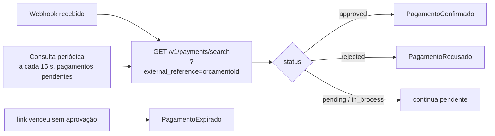

# RFC 004 — Integração com o Mercado Pago

- **Status:** proposta (detalhes de API a confirmar na implementação, contra a documentação vigente do Mercado Pago)
- **Data:** 2026-11-15
- **Serviço:** Billing

---

## 1. Problema

O enunciado exige integrar o pagamento ao Mercado Pago. O pagamento é um passo da
saga: só depois dele o reparo é liberado. Se o reparo não puder ser feito, o pagamento
precisa ser **estornado**. Três perguntas a responder:

1. Qual produto do Mercado Pago usar para cobrar?
2. Como o Billing fica sabendo que o cliente pagou?
3. Como devolver o dinheiro?

## 2. Restrições

- O cliente usa um navegador; a oficina não quer coletar dados de cartão (PCI).
- O ambiente da demonstração é **sandbox** (credenciais e usuários de teste do
  Mercado Pago).
- O load balancer da aplicação é **restrito por IP** desde a fase 3, e o ambiente
  local nem tem URL pública. O webhook do Mercado Pago pode **não conseguir chegar**.

## 3. Proposta

### 3.1 Cobrança: Checkout Pro

Ao receber `SolicitarPagamento`, o Billing cria uma **preferência de pagamento**
(`POST /checkout/preferences`) com:

| Campo | Valor |
| --- | --- |
| `items` | Uma linha por item do orçamento (descrição, quantidade, preço unitário) |
| `external_reference` | `orcamentoId`: é por ele que o pagamento volta a ser encontrado |
| `notification_url` | `https://<billing-publico>/webhooks/mercadopago`, quando houver rota pública |
| `expires` / `expiration_date_to` | Agora + 30 min (prazo de pagamento da saga) |
| `back_urls` | Página de status da OS na área do cliente |

A resposta traz o link de pagamento (`init_point`, ou `sandbox_init_point` no
sandbox). Ele vai no evento `PagamentoSolicitado` e aparece para o cliente na consulta
da OS.

**Por que Checkout Pro:** o cartão é digitado no ambiente do Mercado Pago, então a
oficina não toca em dado sensível. Funciona com usuários de teste, e o sandbox permite
forçar aprovação ou recusa pelo nome do titular do cartão de teste. É isso que torna o
caminho de falha demonstrável.

### 3.2 Confirmação: consulta periódica + webhook

Os dois caminhos convergem para a **mesma ação**: consultar o pagamento na API e agir
sobre o que a API disser.

- **A consulta periódica é a garantia.** Ela funciona sem URL pública (ambiente local,
  load balancer fechado) e cobre webhook perdido. Usa o `GSI2` da tabela (pagamentos
  pendentes por vencimento) para não varrer nada além do necessário.
- **O webhook é o atalho.** Quando há rota pública, a confirmação chega em segundos em
  vez de até 15 s.
- **O webhook nunca é confiável por si.** A assinatura (`x-signature`, HMAC-SHA256 com
  o segredo da aplicação) é validada, e mesmo assim o corpo é tratado só como aviso: a
  decisão sempre vem da consulta à API. Um webhook forjado, no máximo, antecipa uma
  consulta.
- **Corrida entre webhook e consulta periódica.** A transição `PENDENTE → APROVADO` é
  uma escrita condicional no DynamoDB (`ConditionExpression status = PENDENTE`). Quem
  chegar em segundo perde a condição e não publica nada.

### 3.3 Estorno

`EstornarPagamento` → `POST /v1/payments/{paymentId}/refunds` (estorno total), com
`X-Idempotency-Key = estorno-<orcamentoId>`, para que um reenvio do comando não gere
dois estornos.

Em erro 5xx ou timeout, o Billing tenta de novo com backoff. Esgotadas as tentativas,
emite `EstornoFalhou`, a saga vai para `FALHA` e o alerta dispara: é dinheiro de cliente
preso, e precisa de uma pessoa.

### 3.4 Pagamento depois do cancelamento

Se a consulta encontrar `approved` para um orçamento já `CANCELADO` (o cliente pagou
enquanto a saga expirava o prazo), o Billing **estorna automaticamente** e registra o
ocorrido no histórico do pagamento. Orçamento cancelado nunca fica com dinheiro.

## 4. Exposição do webhook na AWS

| Opção | Prós | Contras |
| --- | --- | --- |
| **A. Só consulta periódica** | Nada a expor | Confirmação em até 15 s |
| **B. Rota no API Gateway existente → Billing** | Um único ponto público, reaproveita o Gateway da fase 3 | Exige integração privada (VPC Link) até o cluster |
| **C. Service `LoadBalancer` público só para o Billing** | Simples | Expõe o Billing inteiro; a proteção vem só da assinatura e do JWT nas outras rotas |

**Proposta: começar com A** (que funciona em qualquer ambiente) **e acrescentar B** na
etapa de nuvem, se o tempo permitir. A saga não depende do webhook; ele só deixa a
demonstração mais rápida.

## 5. Configuração

| Variável | Origem |
| --- | --- |
| `MP_ACCESS_TOKEN` | Credencial de teste da aplicação no Mercado Pago (Secret) |
| `MP_WEBHOOK_SECRET` | Chave de assinatura dos webhooks (Secret) |
| `MP_BASE_URL` | `https://api.mercadopago.com` |
| `MP_PRAZO_PAGAMENTO` | `PT30M` (reduzido na demonstração) |

As credenciais são da conta de desenvolvedor do autor e **nunca** vão para o
repositório.

## 6. Testes

- **Unitários:** mapeamento de status do Mercado Pago para eventos, regras de
  expiração e estorno automático.
- **Integração:** WireMock simulando a API do Mercado Pago (preferência criada,
  aprovado, recusado, erro 5xx no estorno). O CI nunca chama o Mercado Pago de verdade.
- **Manual / vídeo:** sandbox real, com usuário comprador de teste e cartões de teste
  para aprovação e recusa.

## 7. Em aberto

- Confirmar na documentação vigente os nomes exatos dos campos de expiração da
  preferência e o formato do manifesto da assinatura do webhook.
- Avaliar se a API de Orders do Mercado Pago substitui a de preferências com vantagem
  para este caso.
