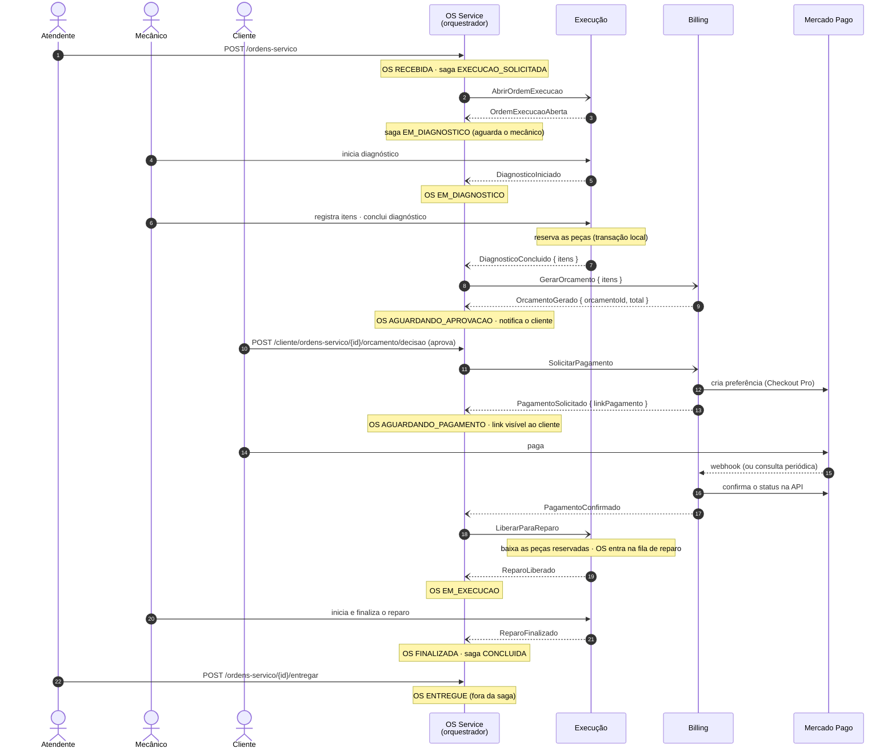
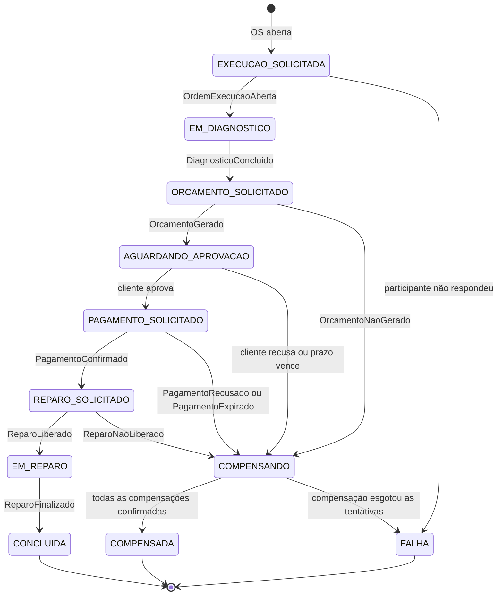
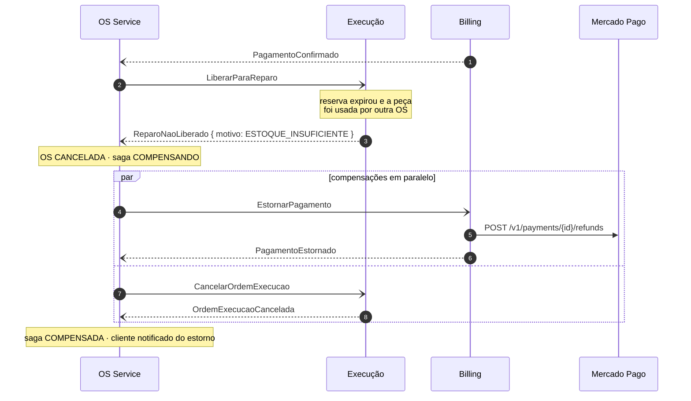

# Saga da Ordem de Serviço

> Desenho aprovado em **2026-11-15**. Escolha do estilo (orquestração) e justificativa:
> [ADR 007](adr/adr-007-saga-orquestrada.md). Formato das mensagens:
> [contratos-mensagens.md](contratos-mensagens.md).

---

## 1. Ideia geral

Uma OS atravessa três serviços. Não existe transação que abranja os três bancos, então
o fluxo vira uma **sequência de transações locais**. Se uma etapa falha, as etapas que
já terminaram são **desfeitas por compensação**: uma nova transação que anula o efeito
de negócio da anterior (cancelar orçamento, liberar peças, estornar pagamento).

O **OS Service é o orquestrador**. Ele guarda, por OS, o estado da saga numa tabela
própria (`sagas`) e decide o próximo passo a cada resposta recebida. Execução e Billing
são **participantes**: recebem comandos, fazem a sua parte e respondem com um evento.

Uma saga por OS, com `sagaId = osId`. Ela nasce na abertura da OS e termina em
`CONCLUIDA` (OS finalizada), `COMPENSADA` (OS cancelada, tudo desfeito) ou `FALHA`
(precisa de intervenção, gera alerta).

---

## 2. Fluxo feliz

Setas cheias (`->>`) são chamadas REST síncronas. Setas abertas (`-)`) são mensagens no
RabbitMQ.

---

## 3. Máquina de estados da saga

`EM_DIAGNOSTICO`, `AGUARDANDO_APROVACAO` e `EM_REPARO` esperam **pessoas** (mecânico,
cliente). Os demais estados esperam **a resposta de um serviço**, e são esses que têm
timeout técnico (§6).

Qualquer estado `*_SOLICITADO` vai para `FALHA` se o participante não responder depois
dos reenvios. O diagrama mostra a transição só a partir de `EXECUCAO_SOLICITADA` para
não poluir. Silêncio não é recusa: sem resposta, não dá para saber se o outro lado
executou ou não. Compensar no escuro poderia, por exemplo, liberar peças de um reparo
que já começou. Por isso a saga para e chama uma pessoa.

### Relação com o status da OS

O status da OS é o que o cliente vê. O estado da saga é o que o orquestrador controla.
Eles andam juntos, mas não são a mesma coisa:

| Status da OS | Estado(s) da saga |
| --- | --- |
| `RECEBIDA` | `EXECUCAO_SOLICITADA`, `EM_DIAGNOSTICO` (antes do mecânico começar) |
| `EM_DIAGNOSTICO` | `EM_DIAGNOSTICO`, `ORCAMENTO_SOLICITADO` |
| `AGUARDANDO_APROVACAO` | `AGUARDANDO_APROVACAO` |
| `AGUARDANDO_PAGAMENTO` **(novo)** | `PAGAMENTO_SOLICITADO` |
| `EM_EXECUCAO` | `REPARO_SOLICITADO`, `EM_REPARO` |
| `FINALIZADA` → `ENTREGUE` | `CONCLUIDA` |
| `CANCELADA` | `COMPENSANDO`, `COMPENSADA` |

A OS só vai para `CANCELADA` quando a compensação **começa**, não quando termina. Para o
cliente, a decisão de cancelar já foi tomada; a limpeza nos outros serviços é detalhe
interno, visível pelo endpoint administrativo da saga (§8).

---

## 4. Compensações

Cada etapa concluída tem uma ação que a desfaz. O orquestrador sabe quais etapas já
terminaram e dispara **só as compensações necessárias**, todas ao mesmo tempo:

| Falha em | Execução: `CancelarOrdemExecucao` (libera reservas) | Billing: `CancelarOrcamento` | Billing: `EstornarPagamento` |
| --- | :---: | :---: | :---: |
| `OrcamentoNaoGerado` | ✅ | — | — |
| Cliente recusa / prazo de aprovação vence | ✅ | ✅ | — |
| `PagamentoRecusado` / `PagamentoExpirado` | ✅ | ✅ | — (nada foi cobrado) |
| `ReparoNaoLiberado` | ✅ | — | ✅ (o estorno também cancela o orçamento) |

Regras das compensações:

- **São idempotentes.** Cancelar uma ordem já cancelada ou estornar um pagamento já
  estornado responde "feito", sem efeito duplicado.
- **Não podem "falhar de vez" por regra de negócio.** Elas só falham por problema
  técnico (serviço fora do ar, Mercado Pago indisponível), e nesse caso são
  reenviadas. Se as tentativas se esgotarem, a saga vai para `FALHA` e dispara o alerta.
  Dinheiro preso ou peça bloqueada precisa de uma pessoa olhando.
- **Cada uma tem confirmação** (`OrdemExecucaoCancelada`, `OrcamentoCancelado`,
  `PagamentoEstornado`). A saga só fecha como `COMPENSADA` quando todas chegam.

### Exemplo: falha depois do pagamento

O caso mais importante, porque envolve devolver dinheiro:

### Por que a reserva pode expirar

As peças são reservadas no fim do diagnóstico, para que o orçamento só ofereça o que
existe. Mas uma oficina não segura peça para sempre esperando o cliente decidir. Por
isso **a reserva tem validade** (configurável; 48 h por padrão).

Quando o pagamento chega depois disso, a Execução tenta reservar de novo. Se não houver
saldo, responde `ReparoNaoLiberado`. É uma falha real de negócio, e é ela que permite
demonstrar o estorno no vídeo: basta configurar uma validade curta.

---

## 5. Garantias de entrega

Mensageria entrega **pelo menos uma vez**: mensagem pode chegar duplicada, atrasada ou
fora de ordem. A saga só é correta se cada parte se proteger disso. Detalhes no
[ADR 010](adr/adr-010-outbox-e-consumidor-idempotente.md).

| Problema | Proteção |
| --- | --- |
| Gravar no banco e cair antes de publicar a mensagem | **Outbox transacional** nos três serviços: a mensagem é gravada na mesma transação do estado e publicada depois por um relay |
| Mensagem duplicada | **Inbox** (`mensagens_processadas`, chave `messageId`) nos consumidores de eventos; **idempotência pela chave de negócio** (`osId` + tipo do comando) nos participantes |
| Resposta perdida | O participante que recebe um comando já executado **reenvia a resposta** com base no estado atual, em vez de ignorar |
| Mensagem fora de ordem | O orquestrador trava a linha da saga (`SELECT … FOR UPDATE`) e só aplica eventos válidos no estado atual. Evento de passo já superado é descartado (com log); os eventos carregam os dados necessários (por exemplo, `DiagnosticoConcluido` traz `diagnosticoIniciadoEm`) |
| Participante fora do ar | Timeout por passo com reenvio (§6) |
| Mensagem que nunca é processada | Após as retentativas, vai para a **DLQ** da fila e dispara alerta |

---

## 6. Prazos

| Situação | Prazo (padrão) | Ao vencer |
| --- | --- | --- |
| Resposta de um comando (estados `*_SOLICITADO`) | 30 s | Reenvia o comando (backoff, até 3 vezes); depois, `FALHA` |
| Cliente decidir o orçamento | 72 h | Trata como recusa e compensa |
| Pagamento após a criação do link | 30 min (validade do link no Mercado Pago) | O Billing emite `PagamentoExpirado`; o orquestrador tem uma margem própria de 35 min |
| Reserva de peça | 48 h | A Execução expira a reserva; na liberação do reparo, tenta reservar de novo |

Todos os prazos são configuráveis por variável de ambiente. Na demonstração, são
reduzidos para minutos.

Um verificador agendado no OS Service (`@Scheduled`) procura sagas com `prazo < agora`.
Com várias réplicas, cada uma pega sagas diferentes (`FOR UPDATE SKIP LOCKED`).

---

## 7. Casos de borda considerados

- **Pagamento aprovado depois de expirado ou cancelado.** O cliente pode pagar no
  último segundo, enquanto a saga já cancelou o orçamento por prazo. O Billing nunca
  aceita dinheiro de orçamento cancelado: se o Mercado Pago confirmar um pagamento
  desse orçamento, o Billing **estorna automaticamente** e registra o evento.
- **Cliente aprova duas vezes** (duplo clique, retry do navegador). A segunda decisão
  encontra a saga fora de `AGUARDANDO_APROVACAO` e recebe `409 Conflict`, sem gerar um
  segundo pagamento.
- **Webhook falso.** O Billing nunca age pelo conteúdo do webhook. Ele usa o webhook só
  como aviso e consulta o pagamento na API do Mercado Pago antes de qualquer decisão
  ([RFC 004](rfc/rfc-004-integracao-mercado-pago.md)).
- **Mecânico tenta concluir diagnóstico sem estoque.** Isso não é falha de saga: a
  reserva é local à Execução, e a conclusão é recusada na hora com `422`. O mecânico
  ajusta os itens e tenta de novo.

---

## 8. Operação

O OS Service expõe, para administradores:

| Endpoint | Uso |
| --- | --- |
| `GET /admin/sagas/{osId}` | Estado da saga, passo atual, prazo, tentativas e o histórico de mensagens trocadas |
| `POST /admin/sagas/{osId}/reprocessar` | Reenvia o comando do passo atual de uma saga em `FALHA`, depois de resolvida a causa |

Na demonstração, o primeiro mostra a saga andando passo a passo ao lado do trace no New
Relic.
